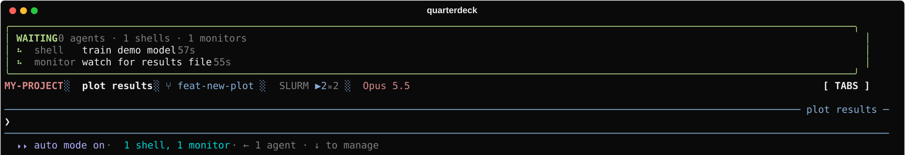
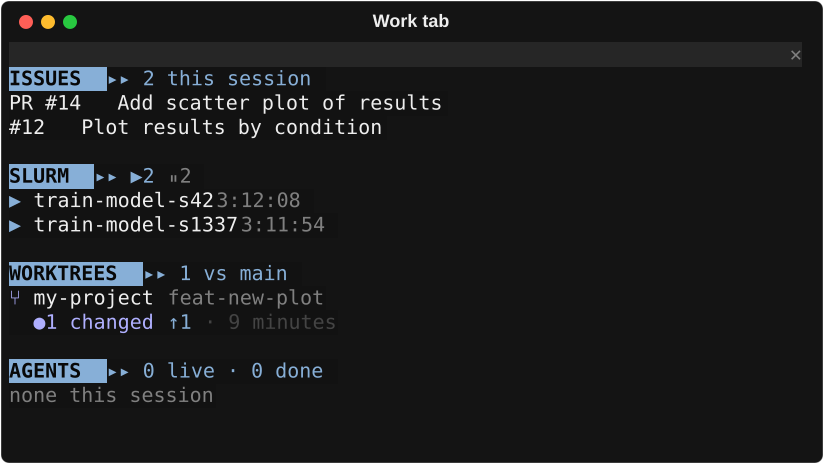
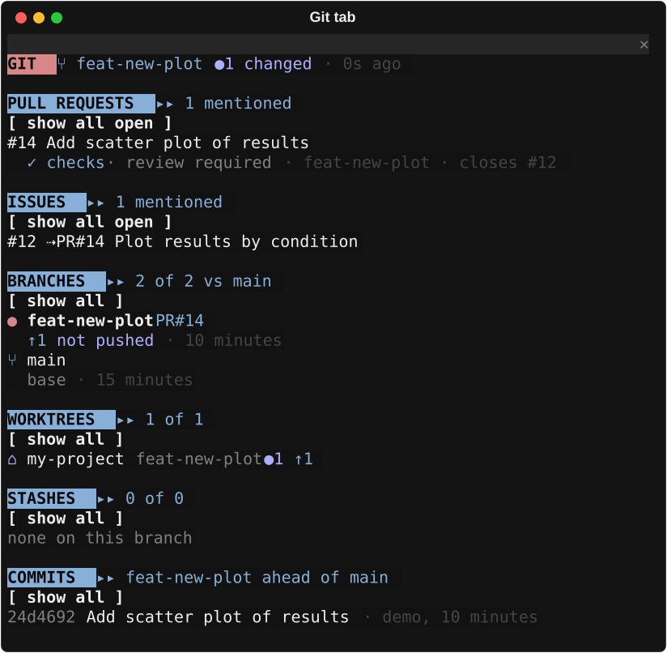
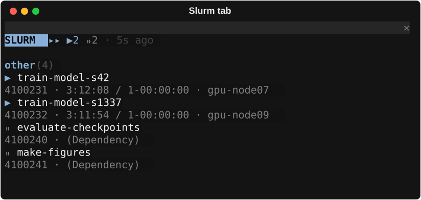
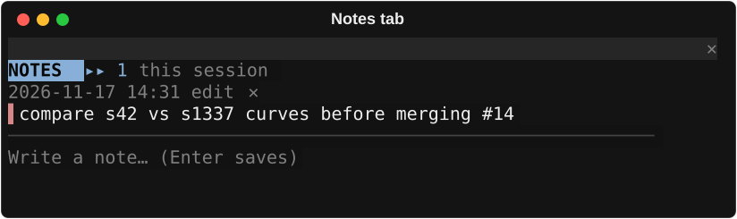
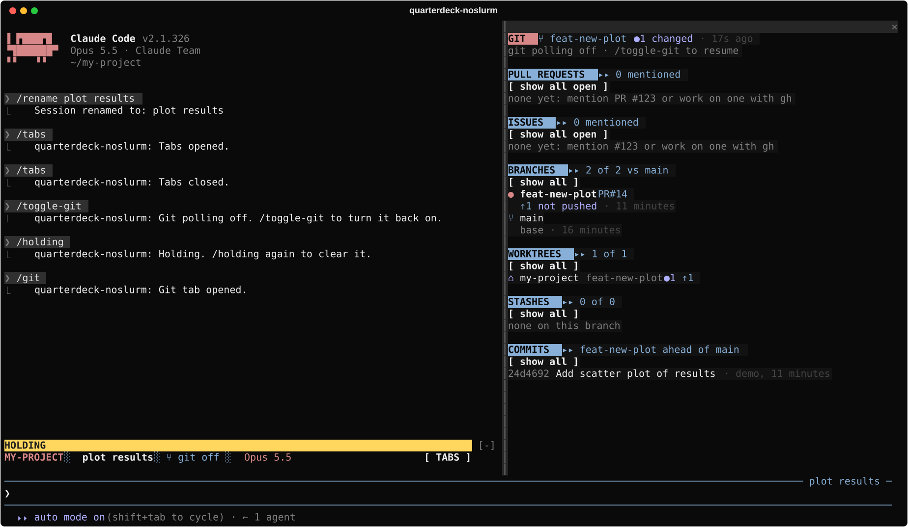

# claude-mods

Personal Claude Code mods, as a plugin marketplace (`riffled-mods`).

| Mod | For |
| --- | --- |
| `reality-plus` | The full skin, including Slurm queue views. Use it on an HPC cluster where `squeue` is available. |
| `reality-plus-noslurm` | The same skin with every Slurm feature removed. Use it on a laptop or any machine without a scheduler. |

Install one or the other, not both: they register the same commands (`/tabs`, `/wave`, `/waiting`, ...).

## reality-plus



A skin for the Claude Code terminal UI:

- HUD strip above the prompt (project, session name, branch, Slurm counts, model, goal progress) with a TABS button
- Tabs: Work, Git (issues, PRs, branches, worktrees, stashes, commits), Slurm, Files, Notes
- `/wave`: a faint animated blue wave with two sloops; the lead ship carries notifications (PR checks, reviews, finished Slurm jobs)
- `/waiting`: a green box of running subagents, background shells and Monitor watches; each spins while live and draws a check (or a red cross on failure) when it ends
- `/holding`: a yellow HOLDING bar marking the session as an open window that needs no attention right now; `/holding` again clears it
- `/label <text>`: an orange bar with your text above the prompt; `/label` alone clears it
- `/toggle-git`: pause git and gh polling (e.g. in a folder that is not a repository, or has no GitHub remote, where every refresh would print an error); the HUD shows `⑂ git off` and the Git and Work tabs say polling is off; `/toggle-git` again resumes it
- Folded tool rows, coloured Bash and diff cards
- `/wrap-up` handoff and `/wind-down` resume prep

### Tabs

TABS (or `/tabs`) opens them all; `/work-panel`, `/git`, `/slurm`, `/files` and `/notes` open one.

| Work | Git |
| --- | --- |
|  |  |
| **Slurm** | **Notes** |
|  |  |

## reality-plus-noslurm

`reality-plus` without Slurm. Everything else is identical. Removed:

- the SLURM ▶/⏸ counts in the HUD strip
- the Slurm tab and `/slurm` (TABS and `/tabs` toggle Work, Git, Files and Notes)
- the Slurm preview in the Work tab
- "job left the queue" notifications (the wave still carries PR checks and reviews)
- the Slurm step of the `/wind-down` brief, which now asks to record any long-running jobs or processes instead



It never calls `squeue`. Its state and notes live under its own name (`~/.claude/mods-data/reality-plus-noslurm/notes/`), separate from `reality-plus`.

## Previews

The images in `docs/previews/` are real captures of Claude Code running these mods (`tmux capture-pane -e`, converted to SVG with [rich](https://github.com/Textualize/rich)), on a throwaway demo repository with stand-in `squeue` and `gh` output, so the jobs, issues and PRs shown are made up.

## Theme

Both mods colour themselves from theme keys. The matching theme ships as `reality-plus/reality-plus.theme.json` ("Reality+": OpenCode neutrals, Claude orange `#D77757` accent, cyan `#5EB0BA`, lavender `#A99CF0`). Install it with:

```
mkdir -p ~/.claude/themes
cp reality-plus/reality-plus.theme.json ~/.claude/themes/reality-plus.json
```

then set `"theme": "custom:reality-plus"` in `~/.claude/settings.json`.

## Install

```
/plugin marketplace add djriffle/claude-mods
/plugin install reality-plus@riffled-mods
```

or, without Slurm:

```
/plugin install reality-plus-noslurm@riffled-mods
```

Check and test with `claude plugin validate <mod>` and `claude plugin test <mod>` (run `test` from inside the mod's directory).
